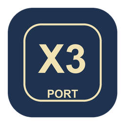

<p align="center"></p>

# Xenoblade Chronicles 3 port for Retroid Pocket 5 & Flip 2

**Made for the Adreno 650.** A native Android port of the console version of **Xenoblade Chronicles 3**, built exclusively for the
**Retroid Pocket 5** and the **Retroid Pocket Flip 2** (Snapdragon 865), from **your own copy** of the game. The game's
own ARM64 code runs directly on the device's CPU, while this project reimplements the parts of the console it talks to.

> **Unofficial, non-commercial fan project.** Not affiliated with, endorsed or sponsored by the console maker or
> Monolith Soft. All trademarks belong to their owners. This repository contains **no game code and no game assets**. To use
> it you need a copy of the game that you bought, with its files extracted on your own console.

## Status

**Version 0.1 — early.** Tested on the Flip 2 with version 2.2.0 and the four DLC: a new game through the
opening movies, the first realtime cutscenes and the first battles into the open field, a saved game loaded again, and
the first big battle against many enemies. The field and normal battles run at 30 fps; heavier battles dip just below
(28.4–29.9 fps measured in handheld mode, 28.5–30 fps in TV mode in that first big battle). It has not been played much
further: later areas may still show problems. The four DLC are loaded if you provide them (the title screen then offers
Future Redeemed), but their content has not been played yet.

- **Handheld or TV mode** (settings panel; takes effect the next time the app is opened). In both, the port picks the
  game's internal resolution from the GPU time it measures. By default the game runs its handheld profile: the 3D is
  drawn at 480×272 to 776×440 and the game's own temporal upscaler outputs at most 1280×720, which reaches the 1080p
  screen stretched. In TV mode the game runs its TV profile: the 3D is drawn at up to 960×544 and the upscaler outputs up
  to 1920×1080; on the Flip 2 it held 848×480 to 904×512 in the field and the first battle, and went as low as 576×328 for
  a few seconds in the big battle. TV mode is sharper and keeps the GPU busier.
- **Language.** The game closes at the title screen if it is asked for a language your copy does not include (seen with
  a European copy, which has no US English). Copy the game's `control.nacp` into the game folder (the port then picks a
  language your copy declares), or create a text file `idioma.txt` there with a language code such as
  `en-GB`, `es` or `fr`.
- The first time a new effect or model appears it can show up a moment late: its shaders are built in the background
  instead of freezing the game. They are cached, so it happens once.
- Known issues: occasional short hitches even in quiet areas (a few frames over 40 ms every ten seconds; the cause is
  not found yet), and rare vertical bars in cutscene close-ups while many shaders are being built.
- Prepared with version 2.2.0. Other versions are accepted with a notice, but the port's own resolution control only
  recognises the 2.2.0 program and stays off with any other (the game's own dynamic resolution is used then; untested).

## Why only the Retroid Pocket 5 and Flip 2

This port was written for one chip, the **Snapdragon 865 with its Adreno 650 GPU**, and tuned to its limits instead of
trying to run everywhere:

- **Run the game, not a whole console.** Translating the full console system costs CPU, GPU and memory this chip does not
  have to spare. Here the game's own ARM64 code runs natively and only what it actually calls (files, threads, input,
  audio, graphics) is reimplemented, so almost the whole device is left for the game.
- **Built around the Adreno 650 and its stock Qualcomm Vulkan driver** (Vulkan 1.1). The graphics layer uses exactly the
  features this driver offers and works around its quirks; for example, GPU shader code that relies on features the
  Adreno 650 only has in compute shaders is rewritten so it renders correctly.
- **A 33 ms budget per frame.** The GPU usually runs at ~587 MHz, so the target is a **locked 30 fps**: the game draws
  its 3D at a dynamic resolution and its own temporal upscaler builds the final image. Where a scene gets heavier than
  that budget, the internal resolution drops for a moment instead of the frame rate.
- **About 2.7 GB of free memory** out of 8 GB while a game runs. GPU caches have fixed limits so a big area never
  pushes the game out of memory, and translated shaders are stored on the device so each one is only built once.
- **Eight cores, used deliberately.** The game's threads run on the four big Cortex-A77 cores; background work (shader
  building, pipeline compiling) goes to the small Cortex-A55 cores so it does not steal time from the game.

Developed and tested on the **Retroid Pocket Flip 2** (Android 13). The **Retroid Pocket 5** has the same chip, memory and
driver, so it should behave the same. Other Snapdragon 865 / Adreno 650 devices might work but are untested; devices
with other GPUs (other Adreno generations, Mali, PowerVR…) are not supported.

## What you need

- **The game files (tested with version 2.2.0; other versions are accepted with a notice)**, already extracted on your own console, as plain folders:
  - **ExeFS** — the folder with `main`, `main.npdm`, `sdk`, … of the game *with the latest update you have applied*
    (any version of the game is accepted; one it was not tested with shows a notice).
  - **RomFS** — the game's RomFS with the same update applied.
- **DLC (optional, Future Redeemed included):** the RomFS of each DLC you own, each in its own folder. Keep the DLC
  title ID in the folder name as your extraction tool named it (for example `... (010074F013263001) ...`): that is how
  the app tells the DLC apart. Folders named `aoc/<index>` (`aoc/1` to `aoc/4`) also work.
- Enough free space for the game plus about 1 GB for the shader cache and saves (internal storage or SD card).

**Where do the files come from?** From your own copy of the game: if your console runs custom firmware, its homebrew
tools can extract the ExeFS and RomFS for you. The app only reads those plain folders (it doesn't open packaged or
protected files), which keeps it simple, and it will tell you exactly what is missing if a folder isn't usable. Questions
about the app itself are always welcome in the issues; just please don't share or ask for game files there.

## Install and first run

1. Download `xenoblade3port-vX.Y.Z.apk` from the [latest release](https://github.com/IamWilmar/xenoblade3-recomp/releases/latest) (or build
   it yourself, below) and install it on the device.
2. Copy your extracted game folders to the device, anywhere you like (for example one folder `Xenoblade3` with the ExeFS
   and RomFS folders inside).
3. Open the app, grant *All files access*, browse to that folder with the touch screen or the d-pad and choose
   **Use this folder**. The app checks that the files are this game, a version it can run (ExeFS and RomFS from the same copy) and not encrypted.
4. Press **Start game**. From then on the app starts the game directly; to choose another folder, switch on
   *Change folder* in the settings panel (see below) or open the app twice in a row (within ten seconds).

Saves, the shader cache and `log.txt` are written into that same folder. The first time you visit each place the game
may stutter while its shaders are translated and compiled; they are cached for the next time.

## Controls and the settings panel

- **The face buttons follow the device's controller mode.** In both of the Retroid's modes (Xbox and Retro) every button
  does what the button in that same place does on the game's original console: B at the bottom, A on the right, X on top,
  Y on the left. You can change the mode from the quick settings while the game is running. Any other controller, over
  USB or Bluetooth (a DualSense, for example), is read by position too: its bottom button is B.
- **Settings panel.** Swipe in from the right edge of the screen (the system's back gesture, the one that shows an arrow)
  and a panel slides out over the game. It has a switch for the FPS counter (your choice is remembered), *TV mode* and *Change
  folder*, which brings the folder screen back the next time you open the app. The same swipe, a tap outside the panel
  or a few seconds without touching it hide it again.

## Options

Creating an empty file (or folder) with one of these names in the game folder changes how the port runs. Most are read
at start-up.

| Name | Effect |
|---|---|
| `modo_tv` | TV mode (the same switch as in the settings panel): the game runs its TV profile. Read at start-up. |
| `con_reinicio_aparte` | Resets the GPU command buffers on a helper thread instead of the render thread. In the first big battle it cut the slow frames; off by default. Read at start-up. |
| `sin_fps` | Hides the FPS counter (the same switch as in the settings panel). |
| `con_barras_sistema` | Keeps Android's navigation and status bars on screen. By default the app hides them while the game runs (swipe in from an edge to bring them up for a moment). Read when the game window gets focus. |
| `botones_xbox`, `botones_retro` | Force the face buttons to be read by position (`botones_xbox`) or by name (`botones_retro`) if a controller comes out swapped. |
| `registro` | Verbose log (line by line) plus a watchdog that prints the game's stack if it hangs. Slower: for debugging. |

## How it works

```
APK
├── SetupActivity (Java)   finds and checks the user's game files, then starts the native activity
└── NativeActivity
    ├── loader             maps main + subsdk* from the ExeFS, applies relocations, links imports,
    │                      patches the few instructions that cannot run on Android (svc, tpidrro_el0, counters)
    └── libnnsdk.so        reimplementation of the console SDK the game imports: nn::os (threads, sync, memory),
        │                  nn::fs (RomFS, saves), nn::hid (controller), audio (AAudio), codecs, …
        └── nvn/           the NVN graphics API on top of Vulkan; the game's Maxwell shaders are translated to
                           SPIR-V with Eden's shader recompiler, then cached
```

The SDK and NVN layers were written from scratch by observing what the game calls and with which values (there are no
official SDK headers or code in this repository); comments next to each deduced value give the evidence. Code comments
are mostly in Spanish.

## Building

Requirements (macOS or Linux): Android SDK with **NDK 28.2.13676358**, build-tools 35.0.0 and platform android-33; a JDK
(17 or newer); CMake ≥ 3.22; Python 3; git, curl and zip.

```bash
tools/setup.sh       # once: fetches the pinned third-party sources (Eden's shader recompiler, sirit, fmt, Boost…)
tools/build_apk.sh   # builds build/xenoblade3port.apk
adb install -r build/xenoblade3port.apk
```

`ANDROID_HOME` selects the SDK (default `~/Library/Android/sdk`). The APK is signed with the Android debug key unless you
pass `KEYSTORE=… KS_PASS=…`. For development, `tools/apk.sh` builds, installs, starts the game on the device connected by
adb and prints its log. The Python scripts in `tools/` are analysis helpers that work on your own extracted files in
`work/` (ignored by git).

## License

GPL-3.0-or-later (see [LICENSE](LICENSE)), because it builds on Eden's shader recompiler (GPL-3.0-or-later). Third-party
components and their licenses are listed in [THIRD_PARTY_NOTICES.md](THIRD_PARTY_NOTICES.md).

---

## En español

Port nativo para Android de la versión de consola de **Xenoblade Chronicles 3**. El código ARM64 del juego corre directo en la
CPU y este proyecto reimplementa el SDK de la consola y la API gráfica NVN sobre Vulkan.

- **Necesitas tu propia copia del juego**, probado con la 2.2.0 (otras versiones se aceptan con un aviso), con el ExeFS y la RomFS ya extraídos en tu consola, como
  carpetas normales. Salen de tu propia copia: si tu consola tiene firmware modificado, sus herramientas homebrew los
  extraen. La app solo lee esas carpetas y te dice qué falta si algo no está. Este repositorio no tiene código ni
  archivos del juego.
- Descarga la APK de [Releases](https://github.com/IamWilmar/xenoblade3-recomp/releases/latest) e instálala. Copia esas carpetas al
  dispositivo, abre la app, dale el permiso de archivos, elige la carpeta y pulsa *Iniciar juego*.
  Las partidas y la caché de shaders se guardan en esa misma carpeta.
- Hecho exclusivamente para la Retroid Pocket 5 y la Retroid Pocket Flip 2 (Snapdragon 865, Adreno 650): todo está
  ajustado a ese chip y a sus límites (30 fps fijos con presupuesto de 33 ms por frame, ~2,7 GB de memoria libre, núcleos
  grandes para el juego). Probado en la Flip 2.
- Los botones quedan donde están en la consola original del juego en los dos modos del mando de la Retroid (Xbox y
  Retro), y cualquier otro mando, por USB o Bluetooth, se lee por posición. Deslizando un dedo desde el borde derecho de
  la pantalla sale un panel de ajustes, con el interruptor del contador de FPS, el del modo TV y el de volver a elegir la
  carpeta. Con la carpeta ya elegida, la app abre el juego directamente.
- Proyecto de fans, sin ánimo de lucro, sin relación con el fabricante de la consola ni
  con Monolith Soft.
- **Idioma:** el juego se cierra en la pantalla de título si se le pide un idioma que tu copia no trae (pasa con la
  copia europea, que no trae inglés de EE. UU.). Copia el `control.nacp` del juego en la carpeta del juego, o crea en
  ella un archivo de texto `idioma.txt` con un código como `es`, `en-GB` o `fr`.
- Los cuatro DLC, Future Redeemed incluido, son opcionales: la RomFS de cada uno en su carpeta, con su id de título en
  el nombre (como lo dejó la herramienta con la que los extrajiste) o como `aoc/1` a `aoc/4`.
